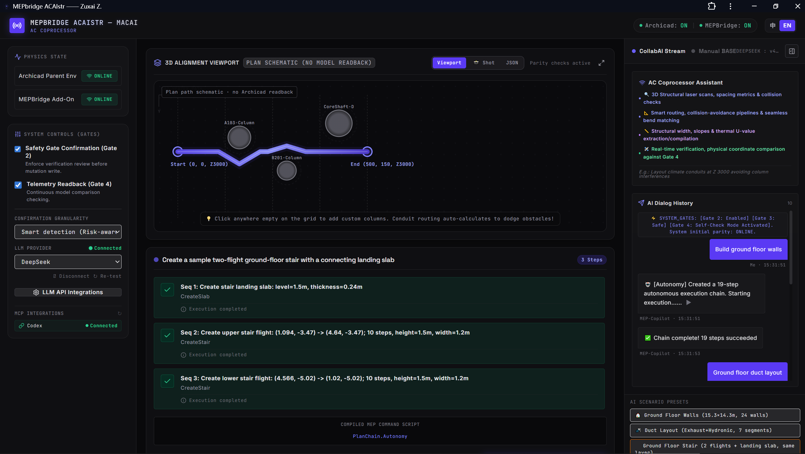
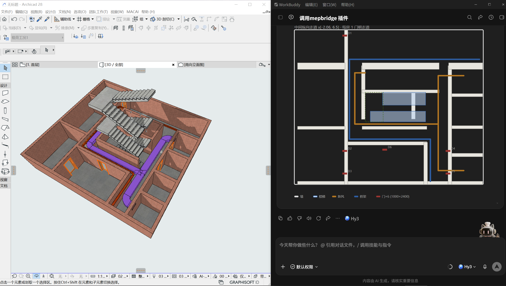
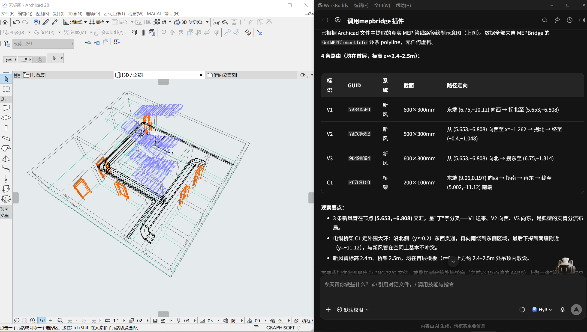

# MEPbridge ACAIstr (MACAI)

> MEPbridge ACAIstr (MACAI) bridges large language models (GPT / Claude / Gemini / Deepseek, etc.) and Archicad industrial-grade 3D design software for safe two-way interaction and an AI Loop collaborative workbench. It provides `CollabAI Smart` (natural-language task planning and autonomous loops) and `Manual` (precise workflow control) entry points.

[](docs/user/INSTALL.md)
[](https://github.com/bleufeng/mepbridge-acaistr/releases/tag/v0.1.9)
[](ai-adapter/tool-descriptors.json)
[](ai-adapter/command-boundary.json)
[-7C3AED.svg)](CHANGELOG.md)
[](CHANGELOG.md)
[](LICENSE)

[中文说明](README.zh-CN.md) | [Installation](docs/user/INSTALL.md) | [Quick Start](docs/user/QUICK_START.md) | [Support](.github/SUPPORT.md)

<p align="center">
  
</p>

Natural-language tasks and extensible user templates pass through safety orchestration and risk gates, connecting design instructions with AI algorithms through structured data, driving Archicad execution via the local Workbench / MCP layer, and reading back structured results to form a closed loop.

## Capability Panorama Dashboard

<table>
  <tr>
    <td><strong>Contract Tools</strong></td>
    <td><code>████████████████████</code> <strong>95 Items</strong></td>
    <td>91 C++ native Add-On commands + 4 Server tools</td>
  </tr>
  <tr>
    <td><strong>Atomic API Scale</strong></td>
    <td><code>█████████████████░░░</code> <strong>162 APIs</strong> (Full 189)</td>
    <td>95 unified contracts polymorphically covering 162 Archicad official atomic capabilities</td>
  </tr>
  <tr>
    <td><strong>Official JSON API</strong></td>
    <td><code>█████████████░░░░░░░</code> <strong>46 / 77 Items</strong> (60%)</td>
    <td>28 C++ supersets + 18 whitelisted proxies (AC30 base)</td>
  </tr>
  <tr>
    <td><strong>Lifecycle Depth</strong></td>
    <td><code>████████████████░░░░</code> <strong>Q1 ～ Q4</strong></td>
    <td>Construction, inspection, in-place mutation & topology</td>
  </tr>
  <tr>
    <td><strong>Transaction Safety</strong></td>
    <td><code>████████████████████</code> <strong>99.8%</strong></td>
    <td>1mm rollback tolerance, 147 live tests 100% zero-dirty</td>
  </tr>
</table>

> Note — Relationship to the official 2,179 DevKit C/C++ APIs: rather than a 1:1 exhaustive exposure, this project uses 95 unified tools to deliver highly cohesive, polymorphic coverage of the 162 atomic capabilities that are most frequently used and most valuable in engineering practice across the official building, MEP, property, and view domains, avoiding the decision hallucinations that large models face when presented with thousands of fragmented interfaces.

## Release Scope & Evolution Milestones

- Version: `v0.1.9` (expanded from single-version support to **full coverage of Archicad 28, 29, and 30**);
- **Capability Scale Evolution**: Grew from ~20 APIs in v0.1.0 and 80+ in v0.1.6 to **162 official atomic API capabilities** today;
- **Transaction Safety Evolution**: Upgraded from raw calls without rollback to unified RAII guards and a **99.8% transaction rollback guard**;
- **Spatial Inspection Precision**: Introduced **0.1mm quantized spatial model snapshots**, A/B diff inspection, and automated revision clouding;
- **Complex Element Depth**: Completed **in-place curtain wall live verification** (GUID-preserved 1.5m equal divisions, 20mm slim frames, and custom panels);
- **Network Endpoints**: Server default `127.0.0.1:19780`; Archicad JSON API local discovery `127.0.0.1:19723-19743`;
- **Package Delivery**: Single complete bilingual package `MACAI-Workbench-v<version>-win64.zip` (includes matching AC28/29/30 APXs, Workbench, and bundled Node runtime; no separate Node.js/npm setup needed).
- **Registered release boundary**: 91 registered C++ commands, 91 Add-On descriptor tools, and 4 local Workbench Server tools (95 tools total).

Public update history: [CHANGELOG.md](CHANGELOG.md).

## Development Layers and the DevKit / C++ Boundary

- **Two Layers**: The native Add-On layer is `MEPBridge.apx`, written in C++ and built against Graphisoft Archicad API and DevKit, communicating via the Archicad JSON API. The Workbench layer is the React UI, Node.js Server, and MCP Server, written in TypeScript/JavaScript without the DevKit.
- **Public Repository Scope**: Only provides the open Workbench layer, tool descriptors, extension modules, examples, and documentation. It does **not** contain native C++ sources, Archicad resources, Graphisoft DevKit samples, APX binaries, or build outputs. The public repository is **not a reproducible APX build source**.
- **Contribution Threshold**: Extending the Workbench, Server, UI, MCP surface, or reviewed modules requires **neither the DevKit nor a C++ toolchain**. The native layer is built internally by maintainers and shipped in the release ZIP.
- **DevKit Provenance**: The DevKit is governed by Graphisoft's license. This project does not distribute it; internal native development requires obtaining the matching DevKit from Graphisoft.

## Example Preview

<table border="0" cellpadding="0" cellspacing="0">
  <tr>
    <td width="50%" align="center">
      <video src="https://github.com/user-attachments/assets/dd0671dd-3e2c-4b34-950c-6cafdf272182" controls muted width="480"></video>
    </td>
    <td width="50%" align="center">
      <video src="https://github.com/user-attachments/assets/ab30744b-9342-4bf5-9e65-189c8fd8b5db" controls muted width="480"></video>
    </td>
  </tr>
  <tr>
    <td width="50%" align="center">
      
    </td>
    <td width="50%" align="center">
      
    </td>
  </tr>
</table>

## Main Capabilities

- **Building Elements & Complex Systems**: Walls, columns, beams, slabs, roofs, doors, windows, stairs, meshes, zones, morphs; in-place curtain wall mutation (GUID-preserved 1.5m divisions, slim frames, custom panel materials)
- **Transforms & Solid Operations (SEO)**: Move, rotate, mirror, multiply; SEO solid operations (subtraction, union, intersection), roof trimming, in-place thickness changes; dual-mode batch engine
- **MEP Engineering Domains**: Piping, ducting, cable carriers, transitions, take-offs; precise nominal diameter matching; spatial collision avoidance with adaptive fitting topology solving
- **Properties & Classification**: 9 attribute families, story management, 224+ property graceful fallback extraction, standard classification assignments (UniFormat)
- **Drafting Perception & Inspection**: Penetrative extraction of 6 2D drafting primitive types (lines, arcs, texts, etc.); 0.1mm spatial model snapshot diffing with automated revision clouding
- **Safety Gates & Result Readback**: `CollabAI Smart` and `Manual` dual entry points, execution strategies (Auto/Supervised/Manual), 1mm tolerance gates, atomic rollback, and structured result readback

### Operation Modes

| Mode or Asset | Primary Use | Typical Flow |
| :--- | :--- | :--- |
| **CollabAI Smart** | Natural-language tasks, template tasks, and AI Loop | Enter goal → Match NL command/template → Generate plan → Confirm risk → Execute & read back |
| **Manual** | Explicit commands, workflow control, and verification | Select command module → Enter parameters → Confirm execution → Inspect structured results |
| **User Templates** | Save and replay verified multi-step plans | Save, search, replay, manage, and delete verified plans |
| **Custom NL Commands** | Extend local natural-language triggers | Map a trigger phrase to a single command or user template |
| **Preset Management** | Manage templates and custom command assets | Import, export, back up, and reset `user-asset-1` bundles |

## Architecture

The system forms a closed AI Loop spanning "intent parsing ➔ plan orchestration ➔ model execution ➔ readback/inspection ➔ corrective iteration":

```text
User / AI Agent (GPT / Claude / Gemini / Deepseek / Cursor)
  |
  +-- CollabAI Smart : Natural Language / Templates / AI Loop
  |     -> Task Planning & Template Matching
  +-- Manual : Structured Commands / Precise Workflow Control
  |     -> Structured Parameter Payload
  +-- MCP Client -> MCP Stdio Server
  |
  v
Safety Orchestration Gates (Schema Validation / Risk Levels / Confirmation)
  |
  v
Node.js Workbench Server  127.0.0.1:19780 /api/execute
  |
  v
Archicad JSON API  127.0.0.1:19723-19743
  |
  v
MEPBridge.apx  C++ Native Add-On (1mm Rollback Guard)
  |
  v
Archicad 28 / 29 / 30  Real 3D Architectural & MEP Model
  |
  v
Structured Result / 0.1mm Diff Snapshot / Audit Trail
  |
  +-- Readback & Self-Healing Loop -> back to the operation entry
```

UI and MCP model operations pass through `/api/execute`. Runtime data (templates, learning memory, audit logs) is stored in `%APPDATA%\MEPBridge` by default.

## Install

1. Download the latest complete package `MACAI-Workbench-v<version>-win64.zip` from [GitHub Releases](https://github.com/bleufeng/mepbridge-acaistr/releases) (contains matching AC28/29/30 APXs, Workbench, and bundled Node runtime; no separate Node.js/npm setup required);
2. Extract to a writable folder (this folder is the Workbench runtime home — do not delete after install);
3. Exit Archicad, open the extracted folder, and run `Install-MEPBridge.cmd`;
4. Restart Archicad;
5. Open Workbench from the Archicad menu, or point your MCP client to `tools/mepbridge-mcp-server.js`.

Manual Server startup is also available from the extracted folder:

```powershell
powershell -NoProfile -ExecutionPolicy Bypass -File tools\Start-BaseWorkbench.ps1 -Action Serve
```

Then visit `http://127.0.0.1:19780/`. See [INSTALL.md](docs/user/INSTALL.md) for full instructions.

## Public Source & Development Extension

The public repository focuses on extending the Workbench UI, Node.js services, and MCP ecosystem.

### Source Layout Overview

```text
ai-adapter/
├── tool-descriptors.json     # 95 lightweight tool descriptor contracts
└── ui/v0.1.0/                # React Workbench source code
server/                       # Node.js Workbench Server (127.0.0.1:19780)
tools/
├── mepbridge-mcp-server.js   # MCP stdio server
└── validate-modules.js       # Module contract validator
modules/                      # Reviewed extension modules & SDK schema
docs/                         # Public user and contributor documentation
```

### Local Development Quick Commands

```powershell
# 1. UI lint and build
cd ai-adapter\ui\v0.1.0
npm ci
npm run lint
npm run build

# 2. Start local Workbench Server
node server\server.js

# 3. Validate extension modules
node tools\validate-modules.js
```

> For full module authoring guidelines, see [MODULE_DEVELOPMENT.md](docs/contributors/MODULE_DEVELOPMENT.md) and [PUBLIC_SOURCE_BOUNDARY.md](docs/contributors/PUBLIC_SOURCE_BOUNDARY.md).

## Safety and Disclaimer

Use a test or backed-up PLN for write, delete, batch, and geometry-changing commands, and review target GUIDs, units, story context, and confirmation prompts before execution.

Users are responsible for ensuring that their use of the Add-On complies with applicable requirements and for their model files, input parameters, backups, and all results produced by this project.

Installing or using this project constitutes acceptance of the associated risks and disclaimer.

## License

Licensed under the [MIT License](LICENSE). See [NOTICE](NOTICE), [SECURITY.md](.github/SECURITY.md), and [SUPPORT.md](.github/SUPPORT.md). This project is a third-party Add-On and is not affiliated with Archicad or Graphisoft.

Use, modification, and distribution are permitted under the MIT License, provided that the original copyright and license notice are retained.

**MEPbridge ACAIstr (MACAI)** — Made by Zuxai Z.(Zhong)<br>
&copy; 2026 Zuxai Z. &middot; MIT License
