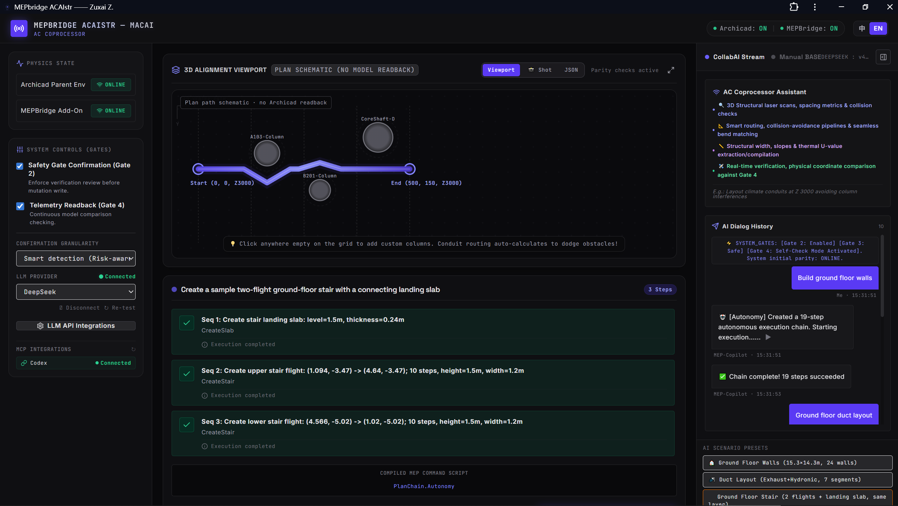
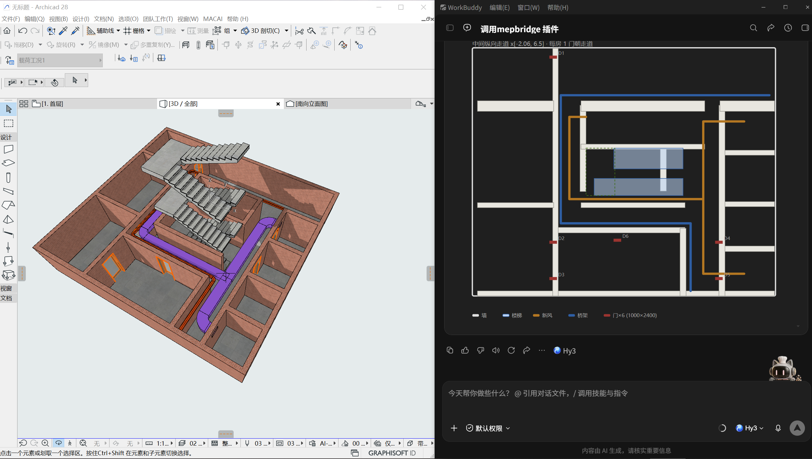
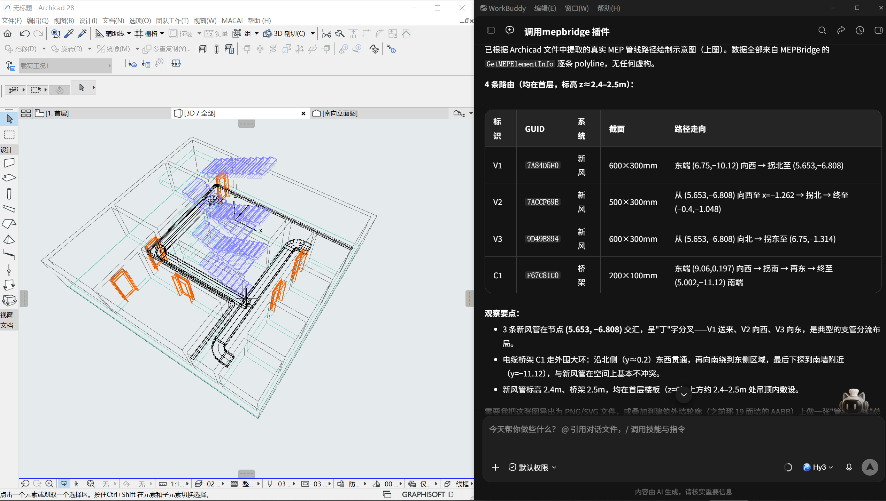
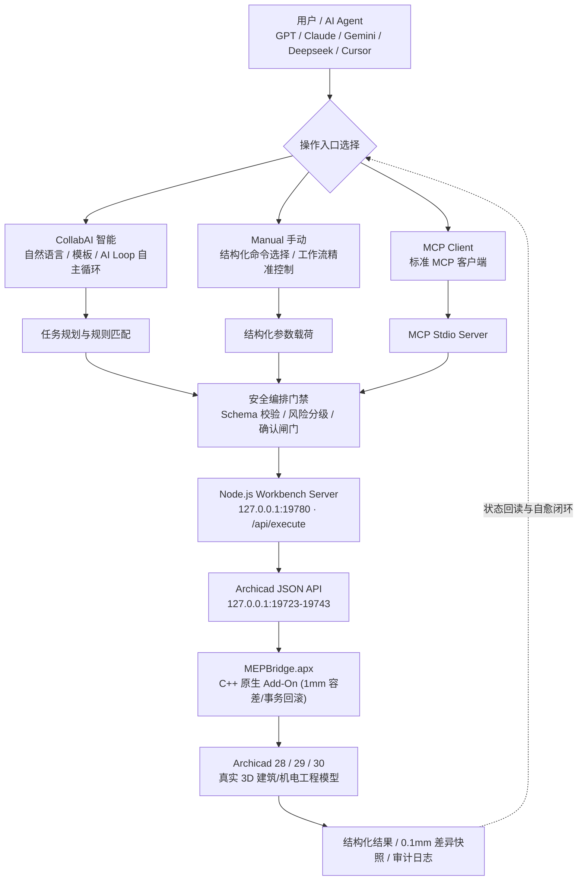

# MEPbridge ACAIstr (MACAI)

> MEPbridge ACAIstr（MACAI）打通大语言模型（GPT / Claude / Gemini / Deepseek 等）与 Archicad 工业级三维设计软件之间的安全双向交互与 AI Loop 智能协同工作台。提供 `CollabAI 智能`（自然语言任务规划与自主循环）与 `Manual 手动`（工作流精准控制）双入口。

[](docs/user/INSTALL.zh-CN.md)
[](https://github.com/bleufeng/mepbridge-acaistr/releases/tag/v0.1.9)
[](ai-adapter/tool-descriptors.json)
[](ai-adapter/command-boundary.json)
[-7C3AED.svg)](CHANGELOG.zh-CN.md)
[](CHANGELOG.zh-CN.md)
[](LICENSE)

[English](README.md) | [安装说明](docs/user/INSTALL.zh-CN.md) | [快速开始](docs/user/QUICK_START.zh-CN.md) | [支持与反馈](.github/SUPPORT.md)

<p align="center">
  
</p>

自然语言任务与可扩展用户模板经过统一安全编排与风险闸门管控，设计指令与 AI 算法深度连通数据，由本地 Workbench / MCP 层驱动 Archicad 执行，并将结构化结果与空间快照回读形成操作闭环。

## 功能全景五大核心看板

依据项目功能全景跟踪台账，系统确立工业级能力的五大核心度量维度：

```text
┌────────────────────────────────────────────────────────────────────────────────────────┐
│                        MEPBridge ACAIstr 功能全景核心能力指标看板                      │
├─────────────────────┬─────────────────────┬─────────────────────┬──────────────────────┤
│ 1. 契约注册边界     │ 2. API 原子功能规模 │ 3. 官方覆盖池       │ 4. Q1–Q4 操控纵深    │
│    95 项 (可见 94)   │    162 项 (全开 189) │    46 / 73 项       │    全周期分项已验    │
├─────────────────────┴─────────────────────┴─────────────────────┴──────────────────────┤
│ 5. 模型事务回滚率：99.8%（实机 147 项 100% 零残留，Zero-Dirty-Model 全宿主闭环）     │
└────────────────────────────────────────────────────────────────────────────────────────┘
```

1. **契约注册边界（95 项）**：91 项 C++ 原生命令（DevKit C++ 族谱绑定）与 4 项本地 Server 协同工具；
2. **API 原子功能规模（162 项，全开 189 项）**：以 95 项统一高内聚契约多态覆盖官方 8 大功能域、162 项原子能力，杜绝碎片化指令膨胀；
3. **官方 JSON API 覆盖池（46 / 73 项）**：28 项 C++ 超集覆盖（更强性能与几何结合）+ 18 项非几何受控白名单透传；
4. **Q1–Q4 操控纵深**：涵盖构造创建 (Q1)、只读感知 (Q2)、原位掩码修改保持母 GUID (Q3，幕墙原位深化实机闭环) 与拓扑求解编排 (Q4)；
5. **模型事务回滚率（99.8%）**：同事务 1mm 精度几何回读校验，超差触发内核级原子回滚与孤儿图元清理，147 项实机验证达成零脏模型残留。

> 附注 —— 与官方 2,179 项 DevKit C/C++ API 的关系：本项目没有采用 1:1 穷举暴露，而是通过 95 个统一工具，对官方在建筑、机电、属性、视图中最高频、最具工程价值的 162 项原子能力 进行了高内聚的多态覆盖，避免了让大模型面对数千个零碎接口而产生决策幻觉。

## 发布范围与版本演进

- 版本：`v0.1.9`（相比早期单版本，现已**全面覆盖 Archicad 28、29、30 三代主流版本**）；
- **能力规模演进**：契约覆盖能力从 v0.1.0 约 20 项、v0.1.6 80+ 项，跃升至当前 **162 项官方原子功能规模**；
- **事务安全演化**：从初期基础调用无回滚，演化为统一内核 RAII 守卫与 **99.8% 事务回滚防线**；
- **空间比对质检**：引入 **0.1mm 量化空间模型快照**与 A/B 差异审阅、修订云线自动圈注；
- **复杂构件纵深**：达成**既有幕墙原位深化实机闭环**（保持母 GUID 1.5m 均分重构、极窄边框与虚实板材定制）；
- **服务网络端点**：Server 默认端口 `127.0.0.1:19780`；Archicad JSON API 本机检测范围 `127.0.0.1:19723-19743`；
- **交付形态革新**：单一双语完整安装包 `MACAI-Workbench-v<version>-win64.zip`（内含 AC28/29/30 APX、Workbench 及便携 Node 运行时，开箱即用，免单独安装环境）。
- **注册发布边界**：91 个注册 C++ 命令、91 个 Add-On descriptor 工具与 4 个本地 Workbench Server 工具（工具合计 95 个）。

公开更新记录：[CHANGELOG.zh-CN.md](CHANGELOG.zh-CN.md)。

## 开发构成与 DevKit／C++ 边界

- **两层实现**：原生 Add-On 层为 `MEPBridge.apx`，以 C++ 编写，基于 Graphisoft 发布的 Archicad API 与 Archicad API Development Kit（DevKit）构建，宿主内通过 Archicad JSON API 交互；Workbench 层为 React UI、Node.js Server 与 MCP Server，使用 TypeScript／JavaScript，不经 DevKit 构建。
- **公开仓库范围**：只提供可公开协作的 Workbench 层及其命令描述符、模块、示例与文档；**不含**原生 C++ 源码、Archicad 资源文件、Graphisoft DevKit／SDK 示例、APX 二进制及构建产物。因此**公开仓库不是可复现的 APX 构建源**。
- **参与门槛**：扩展 Workbench／Server／UI／MCP 与新增审核模块**不需要 DevKit，也不需要 C++ 工具链**；原生层由维护者团队在内部环境构建并随发布 ZIP 提供。
- **DevKit 来源**：DevKit 是 Graphisoft 独立发布并受其许可约束的组件，本项目不代下载、不再分发；内部参与原生层开发须自行从 Graphisoft 获取对应版本并遵守其许可。

## 示例预览

<table border="0" cellpadding="0" cellspacing="0">
  <tr>
    <td width="50%" align="center">
      <video src="https://github.com/user-attachments/assets/dd0671dd-3e2c-4b34-950c-6cafdf272182" controls muted width="480"></video>
    </td>
    <td width="50%" align="center">
      <video src="https://github.com/user-attachments/assets/ab30744b-9342-4bf5-9e65-189c8fd8b5db" controls muted width="480"></video>
    </td>
  </tr>
  <tr>
    <td width="50%" align="center">
      
    </td>
    <td width="50%" align="center">
      
    </td>
  </tr>
</table>

## 主要能力

- **通用建筑与复杂构件**：墙、柱、梁、板、门窗洞口、屋顶、楼梯、地形、区域空间、自由形态 Morph；既有幕墙原位深化实机闭环（保持母 GUID 分格网格均分、极窄边框与虚实板材定制）
- **几何变换与实体布尔 (SEO)**：平移、旋转、镜像、阵列复制；SEO 实体布尔运算（差集/并集/交集）、屋顶修剪与原位厚度修改；全原子与容错双档批量创建
- **机电全专业管网 (MEP)**：给排水水管、暖通风管、电缆桥架、变径、支管引出；公称管径精确匹配；结构碰撞预检与弯头/三通/四通自适应拓扑求解
- **工程属性与分类感知**：9 大属性族读写、楼层标高批量重构、224+ 属性优雅降级提取、行业分类赋码 (UniFormat)
- **图纸感知与空间质检**：穿透提取 6 类底图 2D 图元（线/弧/文字等）；0.1mm 量化空间快照比对、A/B 差异审阅与修订云线自动圈注
- **安全分级与闭环回读**：`CollabAI 智能` 与 `Manual 手动` 双入口、执行策略（自动/监督/手动）、1mm 容差门禁、原子回滚与结构化结果回读

### 操作方式

| 模式或资产 | 定位 | 典型操作 |
| :--- | :--- | :--- |
| **CollabAI 智能** | 自然语言任务、模板任务和 AI Loop | 输入目标 → 匹配 NL 命令或模板 → 生成执行计划 → 风险确认 → 执行并回读 |
| **Manual 手动** | 明确命令、工作流控制和调试验证 | 选择命令模块 → 填写参数 → 确认执行 → 查看结构化结果 |
| **用户模板** | 固化可重放的多步骤计划 | 保存、搜索、重放、管理和删除已验证计划 |
| **自定义 NL 命令** | 扩展本地自然语言触发方式 | 将触发短语映射到单步命令或用户模板 |
| **预设管理** | 管理用户模板和自定义命令资产 | 使用 `user-asset-1` 格式导入、导出、备份和清除重置 |

## 架构

系统形成“意图解析 ➔ 计划编排 ➔ 模型写入 ➔ 结果回读/比对 ➔ 修正自愈”的双向 AI Loop 闭环机制：



UI 与 MCP 模型操作均经过统一受控路由 `/api/execute`。运行时数据（用户模板、学习记忆和审计日志）默认保存在 `%APPDATA%\MEPBridge` 下。

## 安装

1. 从 [GitHub Releases](https://github.com/bleufeng/mepbridge-acaistr/releases) 下载最新的完整安装包 `MACAI-Workbench-v<version>-win64.zip`（内含对应版本的 AC28/29/30 APX 与便携 Node 运行时，无需单独安装 Node.js/npm）；
2. 解压到本地普通可写目录（此目录为 Workbench 运行根目录，安装后请勿删除）；
3. 关闭 Archicad，进入解压目录运行 `Install-MEPBridge.cmd`；
4. 启动 Archicad；
5. 在 Archicad 顶部菜单中点击打开 Workbench，或在 MCP 客户端配置中直接指向 `tools/mepbridge-mcp-server.js`。

手工启动 Server 也可直接在解压目录运行：

```powershell
powershell -NoProfile -ExecutionPolicy Bypass -File tools\Start-BaseWorkbench.ps1 -Action Serve
```

浏览器访问 `http://127.0.0.1:19780/`。完整步骤参见 [安装说明](docs/user/INSTALL.zh-CN.md)。

## 公开源码与开发扩展

本项目公开仓库聚焦于 Workbench 交互层、Node.js 协同服务与 MCP 工具生态的开发与扩展。

### 目录结构概览

```text
ai-adapter/
├── tool-descriptors.json     # 95 项轻量级工具契约注册表
└── ui/v0.1.0/                # React Workbench 前端源码
server/                       # Node.js 协同后端服务 (127.0.0.1:19780)
tools/
├── mepbridge-mcp-server.js   # MCP stdio 服务
└── validate-modules.js       # 模块契约与规范校验器
modules/                      # 审核扩展模块目录与 SDK Schema
docs/                         # 用户与贡献者公开文档
```

### 本地快速调试

```powershell
# 1. 前端 UI 编译检查
cd ai-adapter\ui\v0.1.0
npm ci
npm run lint
npm run build

# 2. 启动本地 Workbench Server
node server\server.js

# 3. 运行扩展模块校验
node tools\validate-modules.js
```

> 完整的模块接入标准与开发指南，请参阅 [模块开发指南](docs/contributors/MODULE_DEVELOPMENT.md) 与 [公开源码边界](docs/contributors/PUBLIC_SOURCE_BOUNDARY.md)。

## 安全与免责声明

在执行写入、删除、批量操作及几何修改类命令时，请务必在测试副本或已备份的 PLN 项目中进行；执行前请仔细核对目标 GUID、单位、楼层上下文及风险确认提示。

用户应自行确保使用本 Add-On 符合相关法律法规与工程设计规范要求，并对输入的参数、模型文件、备份及由此产生的所有设计和工程结果承担全部责任。

安装或使用本项目即表示您已阅读、理解并同意接受上述风险与免责条款。

## 开源许可

本项目采用 [MIT 许可证](LICENSE) 开源。详见 [NOTICE](NOTICE)、[安全政策](.github/SECURITY.md) 与 [支持与反馈](.github/SUPPORT.md)。本项目为第三方独立开发的 Add-On，与 Archicad 或 Graphisoft 官方无关。

在遵守 MIT 许可证条款的前提下，允许自由使用、修改和分发，但必须保留原始版权声明和许可声明。

**MEPbridge ACAIstr (MACAI)** — Made by Zuxai Z.(Zhong)<br>
&copy; 2026 Zuxai Z. &middot; MIT License
